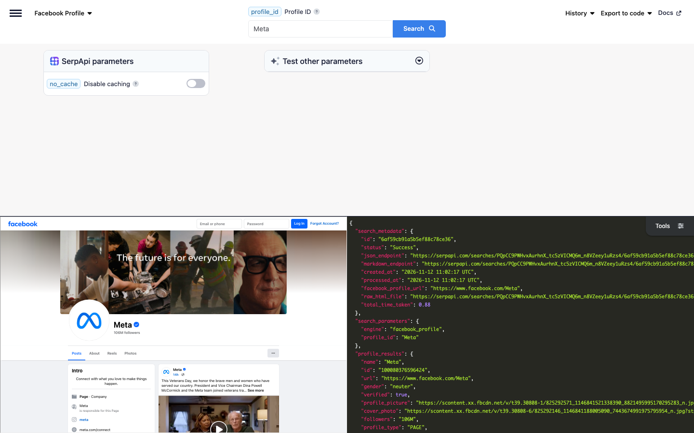

# Facebook Profile Scraper

Scrape Facebook profiles with SerpApi's Facebook Profile API. Look up a Facebook page or profile by its username or ID, and get its name, ID, category, intro text, follower count, verification, profile picture, cover photo, links to its website and other social networks, and photos, plus the address, phone number, email, opening status, price range, rating, and reviews of businesses, and the city, work, and education of public figures.

## How to scrape Facebook profiles

Get the details of a Facebook page or profile with a simple GET request:

```text
https://serpapi.com/search?engine=facebook_profile&profile_id=Meta&api_key=SERPAPI_API_KEY
```

- `profile_id` is the username or ID of the profile, from its link on Facebook, e.g., `Meta` in `https://www.facebook.com/Meta`, or the number in a `profile.php?id=` link, e.g., `100064806517961` in `https://www.facebook.com/profile.php?id=100064806517961` for Katz's Delicatessen. Use the username with the same capitalization as in the link.
- `api_key` is your SerpApi API key. Replace `SERPAPI_API_KEY` with it.

Facebook redirects some IDs to another link, and the response then has no profile and the error "Facebook Profile hasn't returned any results for this query." This happens for some numeric IDs, e.g., Meta's `100080376596424`, which Facebook redirects to `https://www.facebook.com/Meta`, and for some usernames with a different capitalization, e.g., `meta`. Use the username when the profile has one, spelled as in its link or in the `url` of a previous response.

[Register at SerpApi](https://serpapi.com?utm_source=github_facebook_profile_scraper) to get your API key, and keep it private.

### Playground

Try the request live in the [SerpApi Playground](https://serpapi.com/playground?engine=facebook_profile&profile_id=Meta&utm_source=github_facebook_profile_scraper).

[](https://serpapi.com/playground?engine=facebook_profile&profile_id=Meta&utm_source=github_facebook_profile_scraper)

## Code examples

The code examples read your API key from the `SERPAPI_API_KEY` environment variable:

```bash
export SERPAPI_API_KEY="SERPAPI_API_KEY"
```

Each example gets the Meta page and prints its name, category, and number of followers, followed by the title and URL of each of its links.

### curl integration

Send the request with curl, which prints the full JSON response:

```bash
curl --get https://serpapi.com/search \
 --data-urlencode engine="facebook_profile" \
 --data-urlencode profile_id="Meta" \
 --data-urlencode api_key="$SERPAPI_API_KEY"
```

### JavaScript integration

Install the [SerpApi JavaScript library](https://github.com/serpapi/serpapi-javascript) and set your project to use ES modules:

```bash
npm install serpapi
npm pkg set type=module
```

Create an `index.js` file:

```javascript
import { getJson } from "serpapi";

const results = await getJson({
  engine: "facebook_profile",
  api_key: process.env.SERPAPI_API_KEY,
  profile_id: "Meta",
});

const profile = results.profile_results ?? {};
console.log(profile.name, profile.category, profile.followers);
for (const link of profile.links ?? []) {
  console.log(`${link.title}: ${link.link}`);
}
```

Run it with `node index.js`.

### Python integration

Install the [SerpApi Python library](https://github.com/serpapi/serpapi-python):

```bash
pip install serpapi
```

Create a `main.py` file:

```python
import os
import serpapi

client = serpapi.Client(api_key=os.getenv("SERPAPI_API_KEY"))
results = client.search({
    "engine": "facebook_profile",
    "profile_id": "Meta",
})

profile = results.get("profile_results", {})
print(profile.get("name"), profile.get("category"), profile.get("followers"))
for link in profile.get("links", []):
    print(f"{link['title']}: {link['link']}")
```

Run it with `python main.py`.

### Ruby integration

Install the [SerpApi Ruby library](https://github.com/serpapi/serpapi-ruby):

```bash
gem install serpapi
```

Create a `main.rb` file:

```ruby
require "serpapi"

client = SerpApi::Client.new(engine: "facebook_profile", api_key: ENV.fetch("SERPAPI_API_KEY"))
results = client.search(profile_id: "Meta")

profile = results.fetch(:profile_results, {})
puts "#{profile[:name]} #{profile[:category]} #{profile[:followers]}"
profile.fetch(:links, []).each do |link|
  puts "#{link[:title]}: #{link[:link]}"
end

client.close
```

Run it with `ruby main.rb`.

### PHP integration

Install the [SerpApi PHP library](https://github.com/serpapi/serpapi-php):

```bash
composer require serpapi/serpapi-php
```

Create an `index.php` file:

```php
<?php
require 'vendor/autoload.php';

use SerpApi\Client;

$client = new Client(getenv('SERPAPI_API_KEY'), 'facebook_profile');
$results = $client->search([
  'profile_id' => 'Meta',
]);

$profile = $results->profile_results ?? null;
echo ($profile->name ?? '') . ' ' . ($profile->category ?? '') . ' ' . ($profile->followers ?? '') . PHP_EOL;
foreach ($profile->links ?? [] as $link) {
  echo $link->title . ': ' . $link->link . PHP_EOL;
}
```

Run it with `php index.php`.

### Go integration

Create a Go module and install the [SerpApi Go library](https://github.com/serpapi/serpapi-golang):

```bash
go mod init example.com/facebook-profile
go get github.com/serpapi/serpapi-golang
```

Create a `main.go` file:

```go
package main

import (
	"fmt"
	"os"

	"github.com/serpapi/serpapi-golang"
)

func main() {
	setting := serpapi.NewSerpApiClientSetting(os.Getenv("SERPAPI_API_KEY"))
	setting.Engine = "facebook_profile"
	client := serpapi.NewClient(setting)

	results, err := client.Search(map[string]string{
		"profile_id": "Meta",
	})
	if err != nil {
		panic(err)
	}

	profile, _ := results["profile_results"].(map[string]interface{})
	fmt.Println(profile["name"], profile["category"], profile["followers"])
	links, _ := profile["links"].([]interface{})
	for _, item := range links {
		link := item.(map[string]interface{})
		fmt.Printf("%v: %v\n", link["title"], link["link"])
	}
}
```

Run it with `go run .`.

### Rust integration

Create a Cargo project and add the [SerpApi Rust library](https://github.com/serpapi/serpapi-rust) and Tokio:

```bash
cargo new facebook-profile && cd facebook-profile
cargo add serpapi tokio --features tokio/full
```

Replace `src/main.rs` with:

```rust
use serpapi::serpapi::Client;
use std::collections::HashMap;
use std::env;

#[tokio::main]
async fn main() -> Result<(), Box<dyn std::error::Error>> {
    let mut default = HashMap::new();
    default.insert("api_key".to_string(), env::var("SERPAPI_API_KEY")?);
    default.insert("engine".to_string(), "facebook_profile".to_string());
    let client = Client::new(default)?;

    let mut parameter = HashMap::new();
    parameter.insert("profile_id".to_string(), "Meta".to_string());

    let results = client.search(parameter).await?;
    let profile = &results["profile_results"];
    println!(
        "{} {} {}",
        profile["name"].as_str().unwrap_or_default(),
        profile["category"].as_str().unwrap_or_default(),
        profile["followers"].as_str().unwrap_or_default()
    );
    if let Some(links) = profile["links"].as_array() {
        for link in links {
            println!(
                "{}: {}",
                link["title"].as_str().unwrap_or_default(),
                link["link"].as_str().unwrap_or_default()
            );
        }
    }
    Ok(())
}
```

Run it with `cargo run`.

### Other programming languages

Official libraries are also available for [Java](https://github.com/serpapi/serpapi-java), [.NET](https://github.com/serpapi/serpapi-dotnet), [Swift](https://github.com/serpapi/serpapi-swift), and [C++](https://github.com/serpapi/serpapi-cpp). See [SerpApi integrations](https://serpapi.com/integrations?utm_source=github_facebook_profile_scraper) for setup guides, or use a simple GET request from any programming language.

### Errors

Failed requests return an HTTP error status and a JSON body with an `error` message. The most common are `401` for an invalid API key, `400` for a missing required parameter such as `profile_id`, and `429` when you exceed your hourly throughput limit or run out of searches. See [API status and error codes](https://serpapi.com/api-status-and-error-codes?utm_source=github_facebook_profile_scraper) for the full list.

A request without a profile still returns `200`, with `search_metadata.status` set to `Success`, `search_information.profile_results_state` set to `Fully empty`, and the error "Facebook Profile hasn't returned any results for this query.", so check for `error` before reading `profile_results`. This happens for a profile ID that doesn't exist, where Facebook shows "This content isn't available right now", and for an ID that Facebook redirects to another link.

## Output formats: JSON and Markdown

Choose structured JSON for applications or Markdown for LLMs and AI agents:

- JSON is the default output and is useful when you need individual result fields.
- Add `output=md` to receive Markdown instead, which is more token-efficient.

Markdown is plain text, not JSON: YAML front matter with the search metadata, followed by the details of the profile as a list, and tables of its links and photos. Personal profiles also get tables of their work and education. For a request without a profile, the search information and the error follow the front matter instead. Read the response body as text instead of parsing it.

| Client | Markdown request |
|--------|------------------|
| curl | `--data-urlencode output="md"` |
| Python | `client.search({..., "output": "md"})` |
| PHP | `$client->md([...])` |
| Go | `client.Md(map[string]string{...})` |
| Rust | `client.md(parameter).await?` |

If your SDK doesn't have a Markdown helper yet, send a plain HTTP request with `output=md` and read the body as text. Learn more about [Markdown output](https://serpapi.com/markdown-output?utm_source=github_facebook_profile_scraper).

## Facebook Profile API parameters

See the [Facebook Profile API documentation](https://serpapi.com/facebook-profile-api?utm_source=github_facebook_profile_scraper) for more details.

| Name | Description | Requirement |
|------|-------------|-------------|
| **Search query** | | |
| `profile_id` | The username or ID of the Facebook profile, from its link on Facebook (e.g., `Meta` in `https://www.facebook.com/Meta`), or the number in a `profile.php?id=` link (e.g., `100064806517961` in `https://www.facebook.com/profile.php?id=100064806517961` for Katz's Delicatessen). Use the username with the same capitalization as in the link. When Facebook redirects the ID to another link, the response has no profile. This happens for some numeric IDs (e.g., Meta's `100080376596424`, redirected to `https://www.facebook.com/Meta`) and for some usernames with a different capitalization (e.g., `meta`). | Required |
| **SerpApi parameters** | | |
| `engine` | Set to `facebook_profile`. | Required |
| `api_key` | Your private SerpApi API key. | Required |
| `no_cache` | Set to `true` to request fresh results instead of using the one-hour cache. Can't be combined with `async`. | Optional |
| `async` | Set to `true` for later retrieval through the [Searches Archive API](https://serpapi.com/search-archive-api?utm_source=github_facebook_profile_scraper). Can't be combined with `no_cache` or used with Ludicrous Speed enabled. | Optional |
| `zero_trace` | Enterprise only. Set to `true` to skip storing search parameters, files, and metadata on SerpApi servers. | Optional |
| `output` | Set to `json` (default), `html` for the raw HTML retrieved from Facebook, or `md` for Markdown. | Optional |
| `json_restrictor` | Limit the JSON response to the fields you need. See the [JSON Restrictor](https://serpapi.com/json-restrictor?utm_source=github_facebook_profile_scraper) documentation. | Optional |

## Available data on Facebook profiles (JSON response)

`profile_results` describes the page or profile: its name, IDs, pictures, follower counts, intro, and category, plus the contact details, opening status, and reviews of businesses, its links, and 9 of its photos. The field guides below describe the possible fields and their types; they aren't literal API responses.

### What you get depends on the profile

Some fields appear only when Facebook shows them:

| Profile | Fields |
|---------|--------|
| A business with a location, e.g., a restaurant, museum, or hotel | `address`, `phone`, `email`, `business_hours` with whether it's open now, e.g., Closed now, and `price_range`, e.g., $$ for Katz's Delicatessen. Media outlets, universities, and government pages can have some of them too, e.g., an `email` for NASA |
| A page with reviews, e.g., Katz's Delicatessen, The Met, Meta, or The White House | `rating` with the share of reviewers who recommend the page, e.g., 98%, and `reviews` with their number, e.g., 52467 |
| A page of a company or an organization | `managed_by` with the organization responsible for the page, from Facebook's Page transparency, e.g., Executive Office of the President for The White House |
| A verified page or profile | `verified` set to `true`. Unverified pages, e.g., Katz's Delicatessen and The Ritz London, have no `verified` |
| A page with a story, e.g., the American Red Cross | `has_stories` set to `true` |
| A page or profile with intro text | `profile_intro_text`, and `profile_type` set to `PAGE` for pages. Pages without intro text, e.g., Nike, have neither |
| A personal profile of a public figure, e.g., Mark Zuckerberg (`zuck`) | `profile_type` set to `PROFILE`, and `current_city`, `hometown`, `relationship`, `educations`, and `works` |
| Another personal profile | `alternate_name`, and `about_details` with the work and education sections of the profile |

Each profile has an `id`, its numeric Facebook ID, and a `url` with the username as Facebook spells it, e.g., `https://www.facebook.com/theritzlondon` for `TheRitzLondon`. `followers` and `following` are strings as Facebook shows them, e.g., 106M. The links to the profile picture, cover photo, and photos are signed Facebook links that expire, e.g., 4 days after the request, so download the images you want to keep. There's no pagination: each response describes one profile.

### Profile details

`profile_results` describes the profile:

```json
{
  "profile_results": {
    "name": "String - Name of the page or profile, e.g., Meta",
    "id": "String - Facebook ID of the profile, e.g., 100080376596424",
    "url": "String - Link to the profile on Facebook, e.g., https://www.facebook.com/Meta",
    "gender": "String - Gender of the profile on Facebook: neuter for most pages, male or female for people and some public figures' pages, or unknown",
    "verified": "Boolean - true if the profile is verified",
    "profile_picture": "String - Link to the profile picture",
    "cover_photo": "String - Link to the cover photo",
    "has_stories": "Boolean - true if the profile has a story",
    "followers": "String - Number of followers, as shown on Facebook, e.g., 106M",
    "following": "String - Number of profiles the profile follows, e.g., 48",
    "profile_type": "String - Type of the profile: PAGE or PROFILE",
    "profile_intro_text": "String - Intro text of the profile, e.g., Connect with what you love to make things happen.",
    "category": "String - Category of the profile, e.g., Company, Deli, Government organization, or Public figure",
    "address": "String - Address of the business, as shown on Facebook, e.g., 205 E Houston St, New York, NY, United States, New York",
    "phone": "String - Phone number, e.g., (212) 254-2246",
    "email": "String - Email address, e.g., cs@katzsdelicatessen.com",
    "business_hours": "String - Whether the business is open now, e.g., Closed now or Always open",
    "price_range": "String - Price range, from $ to $$$$, e.g., $$",
    "managed_by": "String - Organization responsible for the page, e.g., KATZ DELICATESSEN OF HOUSTON STREET INC",
    "rating": "String - Share of the reviewers who recommend the page, e.g., 98%",
    "reviews": "Integer - Number of reviews, e.g., 52467"
  }
}
```

`verified` and `has_stories` only appear when they're `true`. `following` is missing on some pages, e.g., Meta and Google. `business_hours` has the opening status Facebook shows next to the hours, not the hours themselves.

### Links

`links` lists the website and the other social network profiles shown on the profile, e.g., Instagram, X, YouTube, and LinkedIn:

```json
{
  "profile_results": {
    "links": [
      {
        "title": "String - Text of the link on Facebook, e.g., meta.com",
        "link": "String - URL of the link, e.g., https://meta.com/",
        "icon": "String - Link to the icon of the link"
      }
    ]
  }
}
```

### Photos

`photos` has the 9 photos Facebook shows in the Photos section of the profile, which aren't always the latest ones:

```json
{
  "profile_results": {
    "photos": [
      {
        "link": "String - Link to the photo",
        "owner": {
          "type": "String - Type of the owner of the photo, e.g., User",
          "id": "String - Facebook ID of the owner of the photo, e.g., 100080376596424"
        }
      }
    ]
  }
}
```

`owner.type` is `User` for pages too.

### Personal profiles

Personal profiles of public figures, e.g., Mark Zuckerberg's, have the details from the intro of the profile:

```json
{
  "profile_results": {
    "current_city": "String - Current city, e.g., Palo Alto, California",
    "hometown": "String - Hometown, e.g., Dobbs Ferry, New York",
    "relationship": "String - Relationship status",
    "educations": [
      {
        "title": "String - Education, as shown on Facebook, e.g., Studied Computer Science and Psychology at Harvard University",
        "name": "String - Name of the school, e.g., Harvard University",
        "facebook_link": "String - Link to the Facebook page of the school, e.g., https://www.facebook.com/Harvard"
      }
    ],
    "works": [
      {
        "title": "String - Work, as shown on Facebook, e.g., Founder and CEO at Meta",
        "name": "String - Name of the workplace, e.g., Meta",
        "link": "String - Link to the workplace",
        "facebook_link": "String - Link to the Facebook page of the workplace, e.g., https://www.facebook.com/Meta"
      }
    ]
  }
}
```

Other personal profiles have `about_details` instead, with a section for work and for each level of education:

```json
{
  "profile_results": {
    "alternate_name": "String - Alternate name of the person",
    "about_details": [
      {
        "section_type": "String - Type of the section: work, college, or secondary_school",
        "title": "String - Title of the section, e.g., Work, College, or High school",
        "items": [
          {
            "title": "String - Work or education, as shown on Facebook",
            "name": "String - Name of the workplace or school",
            "facebook_link": "String - Link to the Facebook page of the workplace or school",
            "duration": "String - Period of the work or education",
            "location": "String - Location of the workplace",
            "icon": "String - Link to the picture of the workplace or school"
          }
        ]
      }
    ]
  }
}
```

## AI agents and no-code

### MCP

Give AI agents and assistants a Facebook profile lookup tool with the hosted [SerpApi MCP server](https://github.com/serpapi/serpapi-mcp) at `https://mcp.serpapi.com/mcp`.

Claude Code:

```bash
claude mcp add --transport http serpapi https://mcp.serpapi.com/mcp --header "Authorization: Bearer $SERPAPI_API_KEY"
```

Codex, which reads the key from `SERPAPI_API_KEY`:

```bash
codex mcp add serpapi --url https://mcp.serpapi.com/mcp --bearer-token-env-var SERPAPI_API_KEY
```

Other MCP clients:

```json
{
  "mcpServers": {
    "serpapi": {
      "type": "http",
      "url": "https://mcp.serpapi.com/SERPAPI_API_KEY/mcp"
    }
  }
}
```

The server's engine catalog includes the `facebook_profile` engine, and its `serpapi://engines/facebook_profile` resource describes the parameters. Ask your agent to get the details of a Facebook page, e.g., its followers, links, or contact details, with the `facebook_profile` engine. The resulting tool call looks like this:

```json
{
  "name": "search",
  "arguments": {
    "params": {
      "engine": "facebook_profile",
      "profile_id": "Meta"
    }
  }
}
```

See the [MCP integration guide](https://serpapi.com/integrations/mcp?utm_source=github_facebook_profile_scraper) for more clients and self-hosting.

### CLI

Get Facebook profile details from your terminal or from AI agent workflows with the [SerpApi CLI](https://github.com/serpapi/serpapi-cli):

```bash
brew tap serpapi/homebrew-tap
brew install serpapi-cli
```

The CLI picks up `SERPAPI_API_KEY` from your environment. You can also run `serpapi login` to save a key.

```bash
serpapi search engine=facebook_profile profile_id=Meta
serpapi search engine=facebook_profile profile_id=Meta --fields "profile_results.{name, category, followers, links}"
serpapi search engine=facebook_profile profile_id=Meta output=md
```

### No-code tools

Use SerpApi APIs without writing code:

- [NoCodeSerpApi](https://nocodeserpapi.com/)
- [SerpApi with n8n](https://serpapi.com/blog/tag/n8n/)
- [SerpApi with Make](https://serpapi.com/blog/tag/make/)
- [More integrations](https://github.com/serpapi/serpapi-integrations/)

## Use cases

- Track the followers, ratings, and reviews of your brand's Facebook page and your competitors' pages over time.
- Enrich a list of businesses with the address, phone number, email, website, and price range from their Facebook pages.
- Find the website and the Instagram, X, YouTube, and LinkedIn accounts of a brand from the links on its Facebook page.
- Research creators, public figures, and media outlets for influencer marketing, with their category, followers, and verification.
- Check whether a page is verified and which organization manages it before partnering with or citing it.
- Give AI agents, RAG pipelines, and marketing assistants a tool to look up Facebook pages.

## Related scrapers

- [Facebook Marketplace Scraper](https://github.com/serpapi/facebook-marketplace-scraper): Facebook Marketplace listings
- [Instagram Profile Scraper](https://github.com/serpapi/instagram-profile-scraper): Instagram profiles and posts by username
- [YouTube Channel Scraper](https://github.com/serpapi/youtube-channel-scraper): YouTube channel details and videos
- [Google Maps Scraper](https://github.com/serpapi/google-maps-scraper): local businesses with their address, hours, and ratings from Google Maps

## Contact

Feel free to reach out at [contact@serpapi.com](mailto:contact@serpapi.com).
